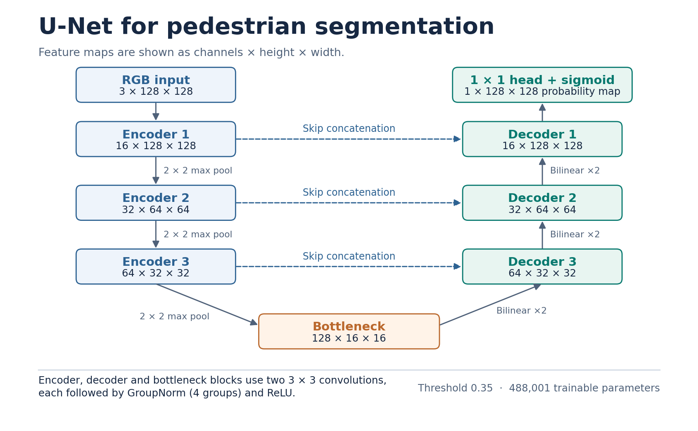

# Pedestrian segmentation with U-Net

Binary pixel segmentation on the Penn–Fudan Pedestrian Database. The model assigns each pixel to either pedestrian or background. Pixels for different people form a single foreground mask.

## Setup

Use Python 3.10–3.12 and run the commands from the project folder. The recorded run used Python 3.12.14 and PyTorch 2.7.1 on CPU.

```text
python -m venv .venv
```

In PowerShell, run the setup using the virtual environment interpreter.

```powershell
.venv\Scripts\python.exe -m pip install torch==2.7.1 --index-url https://download.pytorch.org/whl/cpu
.venv\Scripts\python.exe -m pip install -r requirements.txt
.venv\Scripts\python.exe data.py
```

Use `.venv\Scripts\python.exe` in place of `python` in the remaining commands. On Linux, activate the environment with `source .venv/bin/activate` and run

```text
python -m pip install torch==2.7.1 --index-url https://download.pytorch.org/whl/cpu
python -m pip install -r requirements.txt
python data.py
```

The download script checks the archive checksum and finds 170 paired images and masks under `data/PennFudanPed`. Keep dataset images and annotations in the local `data` folder.

With an Intel or Apple silicon Mac, install PyTorch from PyPI with the other dependencies using `python -m pip install -r requirements.txt`.

## Run a prediction using the included model

```text
python predict.py data/PennFudanPed/PNGImages/FudanPed00001.png
```

Open `runs/prediction.png` to see the binary mask at the original image size. For another image, change the input path. The script loads `results/unet.pt` and reads the validation-selected threshold from `results/metrics.json`.

## Reproduce the experiment

```text
python train.py --epochs 25 --batch-size 8 --seed 42 --threads 6
python figures.py --examples
```

The training script saves its split, checkpoint, learning curves, and per-image test results under `runs/penn-fudan`. The second command creates the diagram and graphs. Use `--examples` to render local comparisons that contain dataset images. Thread count can be reduced on a smaller CPU.

Image–mask pairs are split within each campus group by a fixed random seed. The resulting sets have 120 training, 25 validation, and 25 test pairs. The checkpoint is chosen by validation IoU at threshold 0.50. The foreground threshold is then tuned on the validation set. The test set is used for the final evaluation.



## Recorded test results

| Method | Foreground IoU | Dice | Pixel accuracy |
| --- | ---: | ---: | ---: |
| All background | 0.00% | 0.00% | 83.76% |
| Pixel-position prior from training masks | 27.43% | 43.05% | 67.87% |
| U-Net | **59.03%** | **74.24%** | **91.27%** |

The metrics use pooled pixel counts over the 25 held-out images after resizing. Padded pixels are excluded. The U-Net test precision was 71.25% and recall was 77.49%. See `results/metrics.json` for counts, thresholds, and campus-level results. `results/split.json` lists every sample ID. `results/test_by_image.csv` includes individual test scores.

## References

- Olaf Ronneberger, Philipp Fischer, and Thomas Brox. *U-Net: Convolutional Networks for Biomedical Image Segmentation*, 2015. [Paper](https://arxiv.org/abs/1505.04597)
- Liming Wang, Jianbo Shi, Gang Song, and I-fan Shen. *Object Detection Combining Recognition and Segmentation*, ACCV 2007. [Penn–Fudan Pedestrian Database](https://www.cis.upenn.edu/~jshi/ped_html/)
